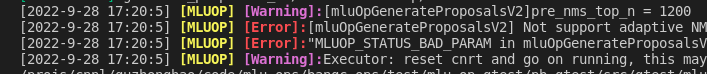

API日志
=================

本章介绍 Cambricon MLU-OPS 的API日志。

执行以下步骤，设置打印 API 日志。新代码优先使用 fmt 风格日志宏；旧的流式日志写法仍可兼容使用。

1. 调用 Cambricon MLU-OPS 函数时，在想要打印信息的位置优先使用下面的 fmt 风格日志宏。宏通过 ``{}`` 占位符接收格式化参数：

   ::

      LOG_ERROR("status={}", status);
      LOG_WARNING("unsupported shape: {}", shape);
      LOG_INFO("workspace size={}", workspace_size);
      LOG_DEBUG1("debug value={}", value);

   这些宏会根据日志等级进行过滤；日志被过滤时不会执行格式化。

2. 在运行 Cambricon MLU-OPS 算子前，设置 :ref:`MLUOP_LOG_MAX_LEVEL` 环境变量指定允许输出的最高日志级别。日志级别满足 ``severity <= max_level`` 时输出；例如设置为 ``WARNING`` 时输出 ERROR 和 WARNING，不输出 INFO 和 DEBUG 日志。

   例如，设置 ``MLUOP_LOG_MAX_LEVEL=WARNING`` 后，下面的日志会输出 ERROR 和 WARNING，不会输出 INFO：

   ::

     LOG_INFO("Information printed on the screen.");
     LOG_WARNING("Information printed on the screen.");
     LOG_ERROR("Information printed on the screen.");

下图为 :ref:`MLUOP_LOG_MAX_LEVEL` 设置为WARNING时打印结果示例。

除此之外，用户可以通过设置 :ref:`MLUOP_LOG_ONLY_SHOW` 环境变量指定打印日志到屏幕的同时生成日志文件。
通过 :ref:`MLUOP_LOG_COLOR_PRINT` 环境变量设置使用颜色字体特效打印日志。详情查看 :ref:`环境变量`。

旧的流式日志写法仍然支持：

::

   LOG(INFO) << "Information printed on the screen.";
   LOG(WARNING) << "Information printed on the screen.";
   LOG(ERROR) << "Information printed on the screen.";

该写法主要用于兼容已有代码；新增代码应优先使用 ``LOG_ERROR``、``LOG_WARNING``、``LOG_INFO`` 和 ``LOG_DEBUG1`` 等 fmt 风格宏。

当前仍存在的 ``VLOG(n) << ...`` 语句继续由 :ref:`MLUOP_MIN_VLOG_LEVEL` 控制，并同时受到 ``MLUOP_LOG_MAX_LEVEL`` 的日志引擎等级过滤。独立的 FATAL 日志语义已移除；需要终止流程时，应通过返回错误、异常或显式终止逻辑实现。
